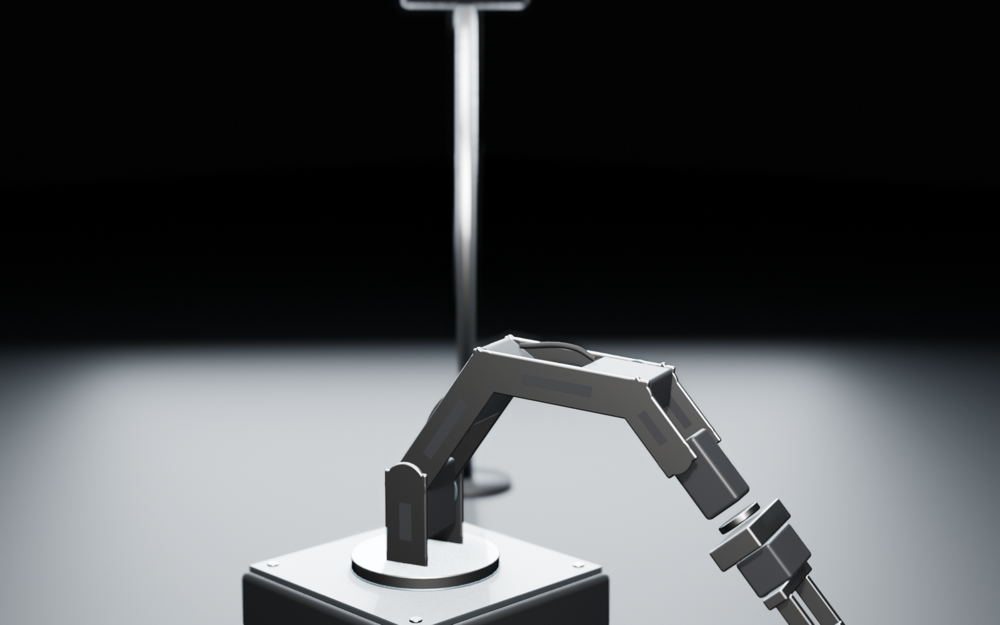

# saintbdrh.github.io

Portfolio of **D. Uuganbadrakh**, electronics engineer, built as one continuous 3D world: a model of his thesis robot (a Yahboom DOFBOT) sorts blocks with his real inverse-kinematics solver. A scroll-driven camera flies through the RealSense view, the kinematics, project screens arranged around the robot, and a lab where visitors drive the arm.

Live: https://saintbdrh.github.io/



## Stack

| | |
|---|---|
| Site | [Astro](https://astro.build) 7, TypeScript, static output |
| 3D | three.js, Draco-compressed glTF |
| Motion | GSAP ScrollTrigger (reveals), Lenis (smooth scroll), custom camera choreography |
| Assets | Blender 5.2, procedural `bpy` script modelled on the measured DOFBOT link lengths (no third-party models) |
| Fonts | Geist, Geist Mono, Source Serif 4, self-hosted via Fontsource |
| Hosting | GitHub Pages via GitHub Actions |

## Develop

```sh
npm install
npm run dev        # http://localhost:4321
npm test           # IK solver unit tests (node --test)
npm run build      # astro check + static build to dist/
npm run preview
```

Rebuild the robot model (requires Blender on `PATH`):

```sh
npm run model      # writes public/models/dofbot.glb
npm run renders    # also writes docs/renders/*.png
```

## Structure

```
blender/build_dofbot.py       procedural DOFBOT-style arm (L1 90, L2 83, L3 83, L4 79.6, L5 102.7 mm) + RealSense on a stand
public/models/dofbot.glb      exported model (Draco, ~150 KB, ~26k triangles)
src/data/content.ts           every factual claim on the site, in one place
src/components/World.astro    the scenes: hero, vision, kinematics, project screens + case-study dialogs, lab
src/components/Profile.astro  capability map, profile, contact
src/scripts/world/world.ts    the single 3D world: studio, workspace, blocks, scroll camera, CSS3D screens, overlays
src/scripts/world/arm.ts      maps thesis joint angles onto the model; joint-space motion
src/scripts/lab/ik.ts         port of the thesis IK (ik_core.py), pure functions
src/scripts/lab/workcell.ts   planar workcell demo carried over from the previous site
tests/ik.test.ts              FK/IK round-trip, joint limits, thesis pick sequence
```

## How the world works

Every scene section carries `data-shot="<name>"`. The world measures where each crosses the viewport centre and blends the camera between neighbouring shots in spherical coordinates, so it orbits rather than cutting through the scene. On screens at least 1000 px wide, the project panels are moved into a CSS3D layer and float in a ring around the robot. Narrower screens keep them in the page flow.

The arm runs the thesis method live: each pick is solved with `solveHover` (nominal L4+L5 tool length), and the move is interpolated in joint space at a servo-like speed limit.

## Honesty notes

- The arm is a **stylised model of the thesis DOFBOT**, built to its measured link lengths, not Yahboom's CAD. The RealSense detections in the vision scene are computed from the simulated scene, and the page says so.
- The Lab is a **simulation**. It uses the measured DOFBOT link lengths and joint limits from [`config.py`](https://github.com/saintbdrh/Vision-guided-robot-sorting/blob/main/config.py) and the solver logic from `ik_core.py`.
- Project figures are architecture and method diagrams. They show no invented readings.

## Accessibility and performance

- `prefers-reduced-motion`: no smooth scrolling, no reveals, a static camera.
- Without WebGL, a still render replaces the 3D stage and every section stays readable.
- All demos work from the keyboard and announce their state through live regions.
- Pixel ratio is capped (1.75 on desktop, 1.5 on small screens) and steps down when frames run long. Shadows are off on small screens. The stage stops rendering when it is off screen, and the Lab loads on approach.
- Print / "Save as PDF" uses a light, static stylesheet.

## Deployment

`.github/workflows/deploy.yml` builds and tests on every pull request and deploys `main` to GitHub Pages.
**Before merging**, switch *Settings → Pages → Build and deployment → Source* to **GitHub Actions**. The repository currently publishes the branch root ("Deploy from a branch"), which would serve the Astro sources instead of the built site.

## Assets and licences

All 3D geometry, renders and diagrams are original to this repository. Fonts: Geist and Geist Mono (SIL OFL), Source Serif 4 (SIL OFL). The Draco decoder is from three.js (MIT).
