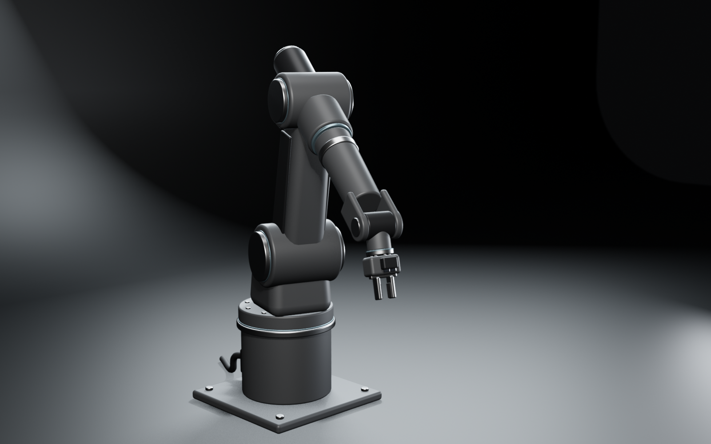

# saintbdrh.github.io

Portfolio of **D. Uuganbadrakh**, electronics engineer: a scroll-driven WebGL study of an original six-axis robot arm, four engineering projects, and an Engineering Lab that runs the inverse-kinematics solver from his thesis.

Live: https://saintbdrh.github.io/



## Stack

| | |
|---|---|
| Site | [Astro](https://astro.build) 7, TypeScript, static output |
| 3D | three.js, Draco-compressed glTF |
| Motion | GSAP ScrollTrigger (reveals), Lenis (smooth scroll), custom camera choreography |
| Assets | Blender 5.2, procedural `bpy` script (no third-party models) |
| Fonts | Geist, Geist Mono, Source Serif 4, self-hosted via Fontsource |
| Hosting | GitHub Pages via GitHub Actions |

## Develop

```sh
npm install
npm run dev        # http://localhost:4321
npm test           # IK solver unit tests (node --test)
npm run build      # astro check + static build to dist/
npm run preview
```

Rebuild the robot model (requires Blender on `PATH`):

```sh
npm run model      # writes public/models/robot.glb
npm run renders    # also writes docs/renders/*.png
```

## Structure

```
blender/build_robot.py        procedural six-axis arm, materials, studio, baked "Survey" clip, GLB export
public/models/robot.glb       exported model (Draco, ~250 KB, ~38k triangles)
public/draco/                 Draco decoder (from three/examples)
src/data/content.ts           every factual claim on the site, in one place
src/components/               Film (hero, engineering, thesis), Projects, Figures, Lab, Profile
src/scripts/main.ts           bootstrap: Lenis, reveals, nav, lazy stage and lab
src/scripts/stage/            WebGL stage and scroll choreography (anchor-relative shots)
src/scripts/lab/ik.ts         port of the thesis IK (ik_core.py), pure functions
src/scripts/lab/lab3d.ts      3D view of the DOFBOT chain driven by ik.ts
src/scripts/lab/workcell.ts   planar workcell demo carried over from the previous site
tests/ik.test.ts              FK/IK round-trip, joint limits, thesis pick sequence
DESIGN.md, PRODUCT.md         design system and product record
```

## How the scroll film works

Every section that drives the camera carries `data-shot="<name>"`. The stage measures where each one crosses the viewport centre and blends between consecutive shots defined in `src/scripts/stage/choreography.ts`. Shots are anchor-relative: they name a node of the model (`A_shoulder`, `A_camera`, …) and an orbit (azimuth, elevation, distance). Interpolation and damping happen in spherical coordinates, so the camera orbits the arm instead of cutting through it.

## Honesty notes

- The six-axis arm is an **original illustrative model**, not the thesis hardware (a Yahboom DOFBOT). The page says so.
- The Lab is a **simulation**. It uses the measured DOFBOT link lengths and joint limits from [`config.py`](https://github.com/saintbdrh/Vision-guided-robot-sorting/blob/main/config.py) and the solver logic from `ik_core.py`.
- Project figures are architecture and method diagrams. They show no invented readings.

## Accessibility and performance

- `prefers-reduced-motion`: no smooth scrolling, no reveals, a static camera.
- Without WebGL, a still render replaces the 3D stage and every section stays readable.
- All demos work from the keyboard and announce their state through live regions.
- Pixel ratio is capped (1.75 on desktop, 1.5 on small screens) and steps down when frames run long. Shadows are off on small screens. The stage stops rendering when it is off screen, and the Lab loads on approach.
- Print / "Save as PDF" uses a light, static stylesheet.

## Deployment

`.github/workflows/deploy.yml` builds and tests on every pull request and deploys `main` to GitHub Pages.
**Before merging**, switch *Settings → Pages → Build and deployment → Source* to **GitHub Actions**. The repository currently publishes the branch root ("Deploy from a branch"), which would serve the Astro sources instead of the built site.

## Assets and licences

All 3D geometry, renders and diagrams are original to this repository. Fonts: Geist and Geist Mono (SIL OFL), Source Serif 4 (SIL OFL). The Draco decoder is from three.js (MIT).
